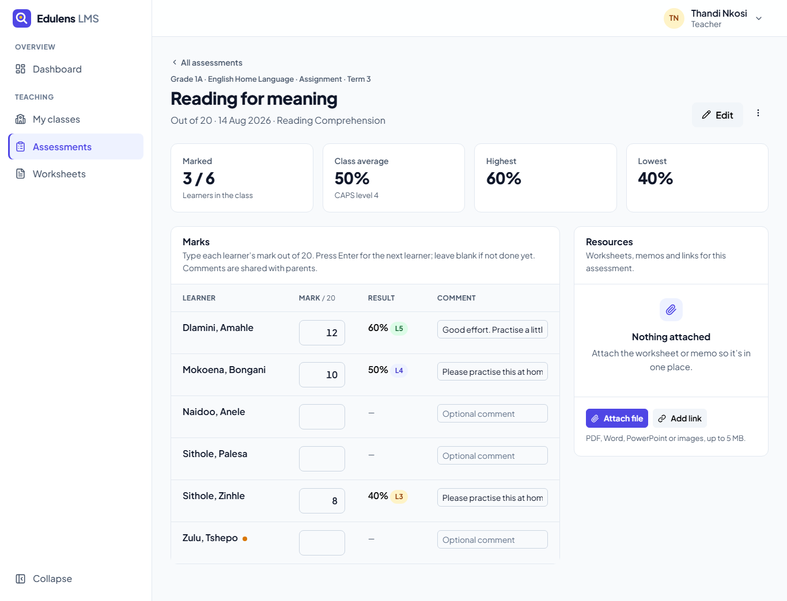
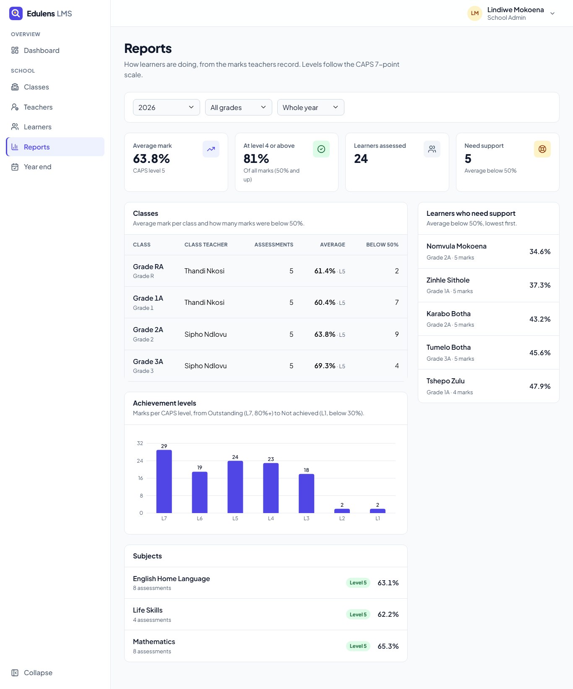
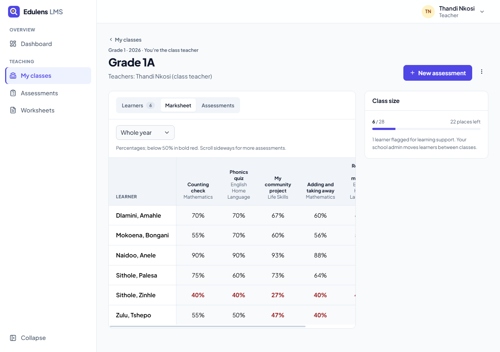
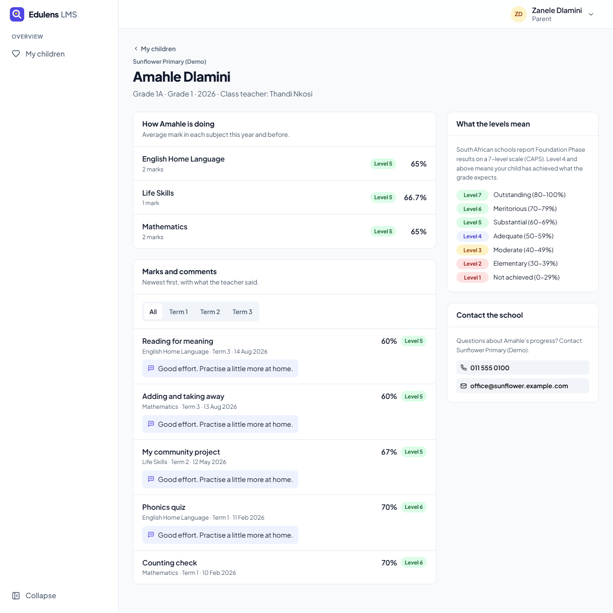
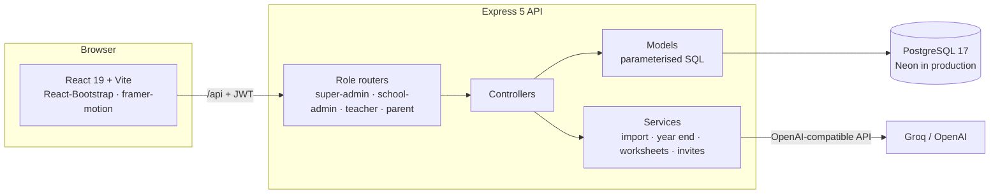

# Edulens LMS

**A learning management system for South African Foundation Phase schools (Grade R – Grade 3).**
Schools organise classes and learners, teachers record marks against the CAPS curriculum, parents follow
their children's progress from their phones, and AI writes printable worksheets.

[](https://edulens-lms.onrender.com)
[](https://github.com/TeekayVuyisile/edulens_mvp/actions/workflows/ci.yml)


> **Try it live: [edulens-lms.onrender.com](https://edulens-lms.onrender.com)**
> On the sign-in page, pick **Teacher**, **School Admin** or **Parent** under *Explore the demo*. You're signed in
> with one click, no password needed. The free server sleeps when idle, so the first visit can take up to a minute.

| Marks entry (teacher) | Reports (school admin) |
|---|---|
|  |  |
| **Marksheet (teacher)** | **Child progress (parent)** |
|  |  |

---

## Why

Foundation Phase teachers in South Africa track learners against **CAPS** and report on a **7-level achievement
scale**. Much of that still lives in paper registers, spreadsheets and WhatsApp groups. Edulens keeps it in one place,
in the language schools already use: grades R–3, terms 1–4, CAPS levels, admission numbers, guardians reached on WhatsApp.

## What each role can do

| Role | Highlights |
|---|---|
| **Super admin** | Add schools and invite their administrators · build curricula (subjects → topics) and assign them per grade and year · platform dashboard |
| **School admin** | Invite teachers · create classes and assign class and support teachers · keep the learner register (or **import it from Excel/CSV** with row-by-row checks) · move learners between classes · school reports by class, subject and CAPS level · **close the academic year** (promote, repeat, finish Grade 3) · invite parents |
| **Teacher** | Dashboard of what still needs marking · class marksheets · create assessments from the class's curriculum · **fast marks entry** (Enter → next learner, live % and CAPS level, comments) · attach worksheets and links · learner profiles · **AI worksheet maker** with a shared school library and printing |
| **Parent** | One login for all their children (even across schools) · marks per subject, every mark with the teacher's comment, and what the CAPS levels mean · read-only |

Learners don't have accounts; they're records the school manages. Staff and parents are **invited** and set their own
passwords: admins never see or choose anyone's password. Invitation links can be emailed or shared on WhatsApp.

## Try it

### The demo

Open the [live demo](https://edulens-lms.onrender.com) and choose a role under **Explore the demo** on the sign-in
page. A banner shows while you're in a demo account, with a button to try another role.

| Role | Try this |
|---|---|
| Teacher | Assessments → *Reading for meaning* (half marked) · Grade 1A marksheet · Worksheets → *New worksheet* |
| School admin | Dashboard → Reports → Year end · open a learner and invite a parent |
| Parent | Amahle (Grade 1A) and Lwazi (Grade 3A); try it on your phone |

The demo is **Sunflower Primary (Demo)**, with 4 classes, 25 learners, five assessments per class with marks and comments,
learners who need support, and one learner waiting for a class. It is shared, so other visitors may have changed things.

To get the same buttons locally, run `npm run seed:demo` and set `DEMO_LOGIN=true` in `backend/.env`. One-click
sign-in is off unless that flag is set, and it only opens the demo school's accounts. `npm run migrate` also creates a
development super admin (`superadmin@edulens.com` / `Admin123!`); on the live site the super admin is private.

### Run it locally

You need **Node.js 20+** and **PostgreSQL 17** (or a free [Neon](https://neon.tech) database).

```bash
# 1. API
cd backend
npm install
cp .env.example .env        # set DB_* (or DATABASE_URL) and JWT_SECRET
npm run migrate             # creates the schema and the development super admin
npm run seed:demo           # optional: demo school and accounts
npm run dev                 # http://localhost:5000/api/health

# 2. Web app (another terminal)
cd frontend
npm install
npm run dev                 # http://localhost:5173 (proxies /api to port 5000)
```

If port 5000 is taken, run the API with `PORT=5055 npm run dev` and the web app with
`API_PROXY_TARGET=http://127.0.0.1:5055 npm run dev`.

### AI worksheets (free with Groq)

Worksheet generation works with **[Groq](https://console.groq.com/keys)** (free tier) or OpenAI. Add a key to
`backend/.env` and restart the API:

```env
AI_PROVIDER=groq
GROQ_API_KEY=gsk_...
# optional: GROQ_MODEL=openai/gpt-oss-20b (the default)
```

If Groq retires a model or your key can't use it, the generator moves on to the next model it knows
(`openai/gpt-oss-120b`, then `llama-3.1-8b-instant`). Without a key, teachers see a clear "not set up yet" message and
everything else works.

## How it's built



| Layer | Choices |
|---|---|
| Frontend | React 19, Vite, React-Bootstrap themed with a custom design system (`docs/design-system.md`), framer-motion, Recharts, Lucide icons |
| Backend | Express 5, raw `pg` (no ORM) with parameterised SQL, express-validator, JWT auth, multer (in-memory uploads), SheetJS for Excel |
| Database | PostgreSQL 17 with numbered, re-runnable SQL migrations (`database/migrations/`) |
| AI | OpenAI SDK against Groq or OpenAI: strict JSON schema output where the model supports it (JSON mode otherwise), every reply validated, with model fallback |
| Hosting | One Render web service (API + built React app on one URL) and a Neon Postgres database |
| Testing & CI | Vitest + Supertest against a real Postgres, Vitest + Testing Library for the UI; GitHub Actions on every push |

### Engineering decisions worth a look

- **Multi-school by design.** Every query is scoped to the caller's school. Teachers reach classes, learners and marks
  only through their class assignments, and parents reach only linked children. Anything outside that scope answers
  *404*, so ids reveal nothing. Tests in `backend/tests/security/` check that this holds.
- **No admin-set passwords.** Invitations and resets use single-use, hashed tokens. Sessions end when a password changes,
  and deactivated users or schools are locked out on their next request.
- **Hardened since the MVP.** SQL injection through dynamic `UPDATE`s was fixed with column allow-lists
  (`backend/src/db/sql.js`). Plaintext passwords that the old activity logger had saved were scrubbed (migration 003).
  Public file uploads became authenticated downloads stored in the database. AI-written HTML (an XSS risk) was replaced
  by validated JSON rendered as React elements.
- **Data integrity in the database.** Class capacity is enforced with row locks, so two admins can't overfill a class.
  Year end runs in one transaction and only once per school and year. Every placement is kept in class history.
- **Real-world inputs.** The register import accepts `DD/MM/YYYY` dates, common column spellings, and phone numbers that
  Excel stripped of their leading 0. It shows every row's problems before anything is saved.
- **Accessible, phone-first UI.** WCAG AA contrast, labelled inputs with inline errors, `aria-invalid` on bad marks,
  keyboard-friendly marks entry, reduced-motion support, and tables that fold into cards at 390px.

## Tests

```bash
cd backend && npm test      # API tests against a throwaway edulens_lms_test database
cd frontend && npm test     # UI tests (jsdom)
bash scripts/ci-local.sh    # everything CI runs: lint, tests and build for both
```

The API suite creates its own `edulens_lms_test` database (the name must end in `_test`), so it never touches
development or production data. It never calls a paid AI API; a local stub covers the provider code.

## Deploying (Render + Neon)

The repo includes a **Render blueprint** (`render.yaml`): one free web service builds the React app and runs the API,
which also serves the app, so everything lives on one URL.

1. **Neon:** create a Postgres 17 project (AWS Frankfurt is closest to Render's Frankfurt region) and copy its
   connection string (`postgres://…?sslmode=require`).
2. **Render:** *New → Blueprint*, pick this repository, then fill in `DATABASE_URL`, `FRONTEND_URL` (the service's
   `https://….onrender.com` URL), `SUPER_ADMIN_EMAIL` / `SUPER_ADMIN_PASSWORD` and, optionally, `GROQ_API_KEY`.
3. Every start runs `npm run start:render`: it applies new migrations, creates the super admin and (with
   `SEED_DEMO=true`) the demo school once, then starts the server. `JWT_SECRET` is generated by Render, and
   `DEMO_LOGIN=true` adds the one-click demo buttons to the sign-in page.
4. Every push to `master` redeploys. Render checks `/api/health` before switching traffic to the new version.

Free Render services sleep after 15 minutes without traffic, so the first visit after a while takes about a minute.
A migration also sets the database time zone to `Africa/Johannesburg`, so dates match what schools see.

## Project layout

```
backend/
  src/routes/          one router per role (+ auth)
  src/controllers/     superAdmin/ schoolAdmin/ teacher/ parent/
  src/models/          SQL per table (Learner, Class, Assessment, Guardian, Worksheet…)
  src/services/        learner import, year end, invites, AI worksheets, activity feed
  tests/               API tests by role, security and database
frontend/
  src/pages/           pages per role, plus dashboards/
  src/components/      ui/ kit, learners/, worksheets/, charts/, layout/
  src/styles/          theme, UI kit and classroom styles
database/migrations/   001–010, applied in order
docs/                  design system and screenshots
render.yaml            Render blueprint
```

## Roadmap

- Attendance registers and term reports parents can download
- Notifications to parents when new marks are released
- Offline-friendly marks entry for schools with patchy connectivity

---

Built by **Teekay** · [github.com/TeekayVuyisile](https://github.com/TeekayVuyisile)
